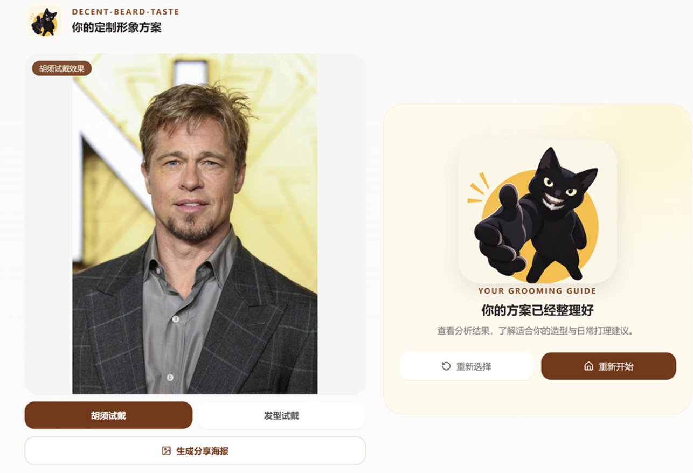
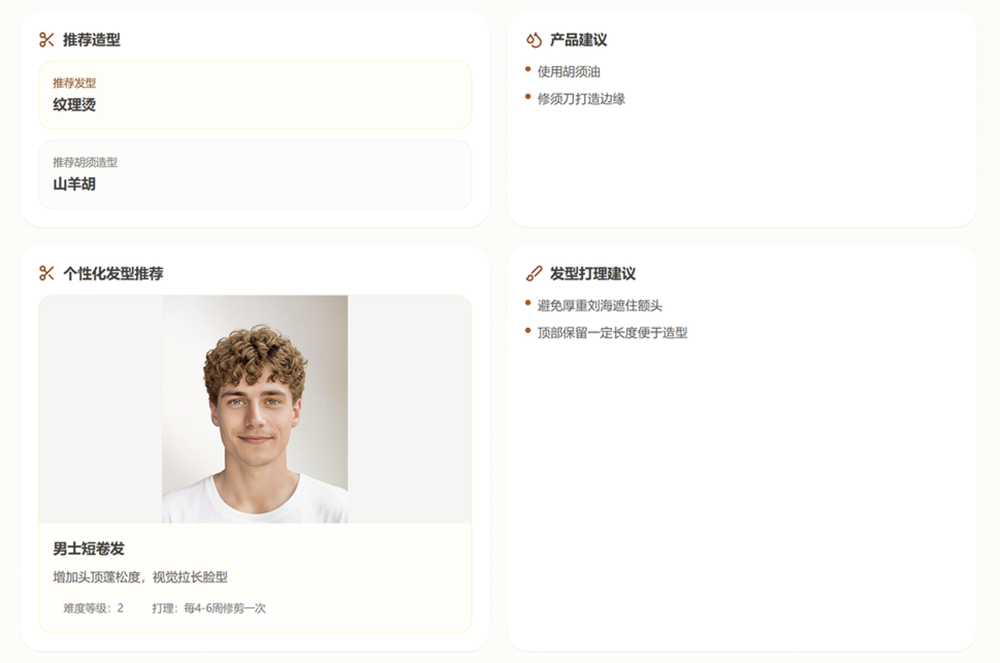

# 🧔 AI 男士面部造型规划系统 (Decent Beard Taste)

> 欧莱雅 Brandstorm 黑客松（L'Oréal Hackathon）参赛项目。基于多模态 AI 算法与 YouCam 生成式 API，为男性提供“诊断 - 推荐 - 虚拟试戴”的一站式面部理容解决方案。



## 💡 项目背景
在美妆科技领域，男士理容长期缺乏专业的数字化辅助。许多男性不知道什么样的发型和胡须适合自己，且线下试错成本极高。本项目结合计算机视觉（CV）、大语言模型（LLM）与 AR 虚拟试戴技术，旨在打破性别刻板印象，让每个男性都能科学、便捷地找到专属的“面子”方案。

## ✨ 核心功能 (Features)
- **📸 智能面部特征分析**：上传一张自拍，自动提取 468 个面部关键点，精准判断脸型（圆脸/方脸/瓜子脸等）及发际线状况。
- **🧠 LLM 专家级推荐**：接入大语言模型（通义千问），像专业理发师一样根据脸型输出千人千面的造型建议及日常打理方案。
- **🎨 AI 胡须虚拟试戴**：基于 YouCam 云端生成式 API，实时渲染山羊胡、络腮胡等多种胡须风格。
- **💇‍♂️ 8 款男士发型自由试戴**：结合真实发型模板，一键预览换上“纹理寸头”、“逗号刘海”等流行发型的惊艳效果。
- **🖼️ 一键分享海报**：后端通过代理解决 Canvas 跨域污染问题，支持将试戴结果生成精美海报保存。

## 🏗️ 系统架构与数据流
本项目采用前后端分离架构，针对 AI 模型的耗时特性，设计了**“本地秒级分析 + 云端异步生成”**的双轨机制。

```text
[用户上传照片] 
      │
      ▼
[React 前端 (Vercel)] ──(Base64)──> [FastAPI 后端 (Railway)]
                                            │
                    ┌───────────────────────┴───────────────────────┐
                    ▼                                               ▼
          [本地边缘计算 (CPU)]                             [云端大模型与 AIGC]
        - MediaPipe 关键点提取                          - 通义千问 LLM (生成推荐理由)
        - OpenCV 图像处理                               - YouCam API (胡须/发型异步试戴渲染)
        - 规则引擎兜底
                    │                                               │
                    └───────────────────────┬───────────────────────┘
                                            ▼
                                  [返回结构化 JSON 数据]
                                            │
                                            ▼
                                [前端 Canvas 渲染热力图与结果]
```

## 🛠️ 技术栈 (Tech Stack)

**前端 (Frontend):**
- React 18 + Vite + TypeScript
- Tailwind CSS (UI 样式)
- HTML5 Canvas (面部热力图绘制与海报生成)

**后端 (Backend):**
- Python 3.11 + FastAPI + Uvicorn
- MediaPipe (468 面部关键点检测)
- OpenCV + ONNX Runtime (发际线图像分割)
- OpenAI SDK (兼容模式下调用阿里云通义千问专属 MaaS 端点)

**部署与运维 (DevOps):**
- 前端托管：Vercel (自动 CI/CD)
- 后端托管：Railway (Docker 容器化部署)
- 依赖与构建：Docker, Nixpacks

## 📡 核心 API 接口说明
后端提供完整的 Swagger 文档 (`/docs`)，核心接口包括：
- `POST /api/analyze`：接收 Base64 图片，返回脸型、特征点坐标与 LLM 推荐方案。
- `POST /api/upload`：对接 YouCam File API，获取供后续 AI 渲染使用的 `file_id`。
- `POST /api/beard-try-on` / `POST /api/hair-try-on`：提交异步 AIGC 渲染任务，返回 `task_id`。
- `GET /api/task/{task_id}`：轮询任务状态，获取最终试戴图片 URL。
- `GET /api/proxy-image`：图片代理接口，专治前端 Canvas 生成海报时的跨域污染问题。

## 🚀 本地运行指南 (Local Setup)

**1. 克隆仓库**
```bash
git clone https://github.com/vindur-bug/decent-beard-taste.git
cd decent-beard-taste
```

**2. 后端配置 (FastAPI)**
```bash
# 创建并激活虚拟环境
python -m venv venv
source venv/bin/activate  # Windows 用户: .\venv\Scripts\activate

# 安装依赖
pip install -r requirements.txt

# 配置环境变量 (需在根目录新建 .env 文件)
```
在 `.env` 中填入你的密钥：
```env
YOUCAM_API_KEY=你的_YouCam_密钥
DASHSCOPE_API_KEY=你的_阿里云_密钥
DASHSCOPE_BASE_URL=你的_专属_MaaS_端点
```
启动后端：
```bash
uvicorn main:app --reload
```

**3. 前端配置 (React)**
```bash
cd frontend
npm install
npm run dev
```

## 🩸 踩坑与排错记录 (Engineering Notes)
在从零搭建本系统并上云的过程中，解决了以下棘手的底层与工程问题：
1. **Linux 系统依赖缺失**：在 Railway Docker 容器中运行 OpenCV 与 MediaPipe 时，遭遇 `ImportError: libEGL.so.1`。通过手写 `Dockerfile` 并精准补全 `libegl1`、`libgles2` 等图形渲染底层库解决。
2. **S3 预签名 URL 权限 403**：YouCam 返回的文件链接仅限 PUT 上传。通过改用 `file_id` 作为 AI 任务输入参数，规避了 AWS S3 的鉴权拦截。
3. **Canvas 跨域污染**：前端生成分享海报时，直接绘制外域图片导致 `Tainted Canvas`。通过手写 `/api/proxy-image` 代理接口，并配合前端 `crossOrigin="anonymous"` 完美解决。
4. **专属 MaaS 端点适配**：阿里云专属 API 密钥无法直接使用标准 `dashscope` SDK。通过阅读官方文档，改用 OpenAI SDK 并重写 `base_url` 实现无缝对接。

## 🙏 致谢
- UI/UX 与前端交互设计：superclip
- 计算机视觉与 CV 算法:Gopatom26
- 推荐规则引擎设计：PlutoisnotChloe
- 后端架构与云服务部署：vindur

---
*Built with ❤️ for the L'Oréal Brandstorm Hackathon.*
```

---
